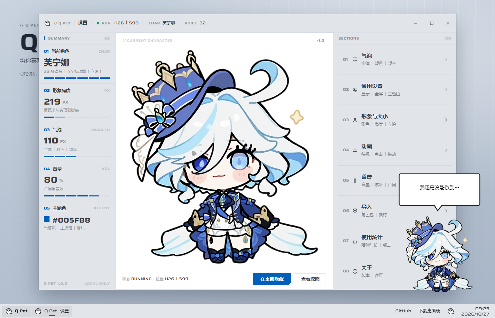

<div align="center">
  
</div>

<h1 align="center">Q Pet</h1>

<p align="center">
  将你喜欢的角色放到桌面上。
</p>

<p align="center">
  
  
  
  
  
</p>

<p align="center">
  <a href="https://github.com/xiezaji/q-pet/archive/refs/heads/main.zip">
    
  </a>
  &nbsp;
  <a href="#快速开始">
    
  </a>
</p>

<div align="center">
  
</div>

Q Pet 是一款桌面宠物：透明置顶、点击穿透、四类动画、语音台词、可换角色，数据只保存在本地。程序使用 Win32 + .NET Framework 4.8 编写，不联网，无第三方依赖。

内置芙宁娜、阿米娅、小维、奶蛙四套角色包，附带预编译程序，解压即可运行。

> **网页版**：不想装东西？直接在浏览器里玩 —— **<https://xiezaji.github.io/q-pet/>**
>
> 它是用原生 JavaScript + Canvas + Web Audio 重写的移植版（源码在 [web/](web/)），
> 资源体积从桌面端的 139 MB 压到 **5.2 MB**（WebP + MP3），手机也能打开。
> 详见 [`web/README.md`](web/README.md)。

<div align="center">
  
</div>

## 功能

- 透明、置顶、不抢焦点，透明区域点击穿透，不占任务栏。
- 待机、按键、点击、拖动四类动画，可单独开关、调速。
- 点击角色随机显示台词并播放语音；台词可编辑、删除单条、导入新语音，文案与音频都只改本地副本。
- 拖动改变位置，下次启动回到原处。
- 气泡支持四种外框、颜色、字体、字号，长文本可滚动。
- 托盘菜单、双击打开设置、开机自启。
- 设置面板「通用设置 → 桌面显示」可一键关掉 / 打开桌宠（关掉后进程直接退出）。
- 角色包就是一个文件夹，新增角色不需要改程序。
- 本地统计屏幕与活跃时长、软件使用、按键次数和角色陪伴时长。

## 演示

<div align="center">
  
</div>

## 设置中心

Windows 11 Fluent 风格设置面板，修改后即时生效。点击图片查看原始尺寸。

| 气泡外观 | 动画调校 |
| :---: | :---: |
| <a href="docs/images/settings-bubble.png"></a> | <a href="docs/images/settings-anim.png"></a> |
| 四种外框，支持自定义颜色、字体与字号 | 四类动画独立开关，幅度与倍速可调 |
| **语音台词** | **使用统计** |
| <a href="docs/images/settings-voice.png"></a> | <a href="docs/images/settings-stats.png"></a> |
| 台词与语音一一对应，可试听、编辑、删除、导入 | 记录仅保存在本机 |

## 角色包

<div align="center">
  
</div>

立绘、动画帧、台词和语音都放在角色文件夹里，角色高度可单独设置。在设置面板中可以新建或导入角色。

<details>
<summary><b>角色包结构</b></summary>

```text
chars/
└─ 角色名/
   ├─ char.json          角色清单
   ├─ 图片/image.png     立绘
   ├─ 动画/frames.bin    动画帧
   ├─ 动画/frames.txt    尺寸与帧数元数据
   ├─ 动画/preview.png   预览图
   ├─ 台词.txt           气泡台词（一行一句）
   └─ 音效/
      ├─ voices.tsv      台词 <TAB> 语音路径
      ├─ voices/*.wav
      ├─ press.wav       可选：按压音
      └─ release.wav     可选：松开音
```

`char.json` 示例：

```ini
name=小维
image=图片/image.png
frames=动画/frames.bin
meta=动画/frames.txt
lines=台词.txt
voicelines=音效/voices.tsv
press=音效/voices/xxx.wav
release=音效/voices/yyy.wav
charH=200
```
</details>

<details>
<summary><b>批量制作与自定义动画</b></summary>

需要 Python 3、numpy、Pillow；导入 mp3 / m4a / ogg 时需要 ffmpeg。

```bat
python charpack.py list
python charpack.py new --name 新角色 --image D:\pics\a.png --voices D:\voices --char-h 219
python charpack.py rebuild --name 新角色 --char-h 260
```

替换某一类动画：

```bat
python anim_custom.py apply --pack "chars/小维" --slot click --src D:\anim.gif
python anim_custom.py reset --pack "chars/小维" --slot click
```

`--slot` 可选 `idle` / `press` / `click` / `drag`。
</details>

## 快速开始

### 系统要求

- Windows 10 / 11（x64）
- .NET Framework 4.8（Windows 10 1903 及以上、Windows 11 默认自带）

### 三步启动

1. **下载整个仓库**：[下载 ZIP](https://github.com/xiezaji/q-pet/archive/refs/heads/main.zip)，或执行 `git clone https://github.com/xiezaji/q-pet.git`，然后**完整解压**。
   不要在压缩包里直接双击，也不要只把 `Pet.exe` 单独拷出来——程序还需要同目录的 `pet-config.txt`、`chars\` 等资源。
2. **双击 `start-pet.cmd`** 启动桌宠（`start-pet.vbs` 启动时无窗口闪烁），也可以直接双击 `Pet.exe`。
3. **双击 `run-pet-settings.cmd`** 打开设置；双击托盘图标也可以。

> **SmartScreen 提示？** 程序未做代码签名，首次运行可能出现「Windows 已保护你的电脑」。点「更多信息 → 仍要运行」即可。
>
> **可以移动吗？** 配置全部使用相对路径，整个文件夹可以放在任意目录，也可以拷到其他电脑或 U 盘。

<details>
<summary><b>常见问题</b></summary>

| 现象 | 处理 |
|---|---|
| 双击后没反应，或提示找不到 exe | 确认 ZIP 已完整解压，`Pet.exe`、`pet-config.txt`、`chars\` 在同一目录 |
| SmartScreen 拦截 | 「更多信息 → 仍要运行」 |
| 桌宠没有出现 | 设置面板「关于」页会直接显示上次崩溃；也可看同目录 `pet-crash.log` / `pet-error.log` / `pet-status.txt` |
| 重复双击开启了多只 | 不会。程序用单实例互斥体；已有实例时会把它的设置面板叫出来，并在 `pet-status.txt` 里留一行 |
| 日志越来越多 | 不会。`pet-status.txt` 只留当天，跨天自动归档成 `pet-status-YYYY-MM-DD.txt`，归档只保留最近 7 天 |
| 桌宠跑到屏幕外 | 拔显示器 / 改分辨率后会自动夹回可视区；也可以删掉 `pet-pos.txt` 让它回默认位置 |
| 想把统计拿走 | 设置面板「统计」页的「导出 CSV」，可导出当天或某一天的软件 / 按键 / 角色时长 |
| 想换电脑继续用 | 复制整个文件夹即可；`pet-pos.txt`、`pet-stats*.txt` 等运行记录可留可删 |
| 不想使用预编译 exe | 参考下方「构建」，从源码自行编译 |
</details>

## 发给朋友

不要直接把 `Pet.exe` 单独发出去：微信 / QQ 会拦 exe，而且单独一个 exe 一定带「来自其他计算机」标记，
对方一运行就弹「Windows 已保护你的电脑」。正确做法是**发一个解压即用的 zip**：

```powershell
# 只带当前角色（约 8 MB，好传）
powershell -ExecutionPolicy Bypass -File pack-for-friend.ps1
# 带 chars\ 下全部角色（约 130 MB）
powershell -ExecutionPolicy Bypass -File pack-for-friend.ps1 -AllChars
```

产物是 `dist\QPet-<日期>.zip`，里面已经放好 `首次运行请先看这里.txt`（含三步说明）。

**关键的一步要提醒对方**：右键 zip → 属性 → 勾「解除锁定」→ 确定，**然后再解压**。
这样解压出来的 exe 不带「来自其他计算机」标记，SmartScreen 根本不会触发。
已经解压了也不要紧，右键 `Pet.exe` → 属性 → 勾「解除锁定」同样有效。

### 另一种分发方式：让朋友自己编译

想彻底不依赖「解除锁定」这一步，可以发源码包，让 exe 在他自己电脑上生成
（本机新编译的文件不带 MOTW，同样不会弹警告）：

```powershell
powershell -ExecutionPolicy Bypass -File pack-source-for-friend.ps1
```

产物 `dist\QPet-源码-<日期>.zip`，对方的操作只有三步：装 [.NET SDK](https://dotnet.microsoft.com/download)
→ 解压 → 双击 `build.cmd`（脚本会自动 `dotnet build` 两个项目并把产物复制到当前目录）。
代价是他要装一次 SDK（几百 MB）；两个 csproj 已带
`Microsoft.NETFramework.ReferenceAssemblies`，没装 .NET Framework 4.8 开发包也能编。

想彻底不弹警告只能买代码签名证书（OV 约千元/年，需实名，签完仍要等信誉积累），
个人自用/送朋友没必要；exe 本身是本机编译的 .NET 程序，Microsoft Defender 实测无检出。

## 操作

| 操作 | 效果 |
|---|---|
| 左键点击角色 | 随机台词气泡 + 对应语音 |
| 按住拖动角色 | 移动位置并记住 |
| 右键角色 | 打开菜单（设置 / 退出） |
| 双击托盘图标 | 打开设置 |
| 右键托盘图标 | 打开菜单（设置 / 退出） |
| 气泡上滚轮或拖动 | 滚动长文本 |

<details>
<summary><b>构建</b></summary>

要求：.NET SDK，以及 .NET Framework 4.8 Targeting Pack（由 Visual Studio 或 Developer Pack 提供）。

```bat
dotnet build Pet.csproj -c Release
dotnet build PetSettings.csproj -c Release
```

产物为 `build\pet\Pet.exe` 和 `build\settings\PetSettings.exe`。将两个 exe 复制到项目根目录即可运行。仓库根目录已附带预编译版本，普通用户无需执行本节步骤。
</details>

<details>
<summary><b>配置</b></summary>

配置保存在根目录 `pet-config.txt`（key=value）。推荐使用设置面板修改：保存时同步更新 `pet-overrides.txt` 与 `pet-config.txt`，重启桌宠后生效。文件内的路径均为相对路径（相对于 `pet-config.txt` 所在目录），整个文件夹可直接移动。

| 键 | 说明 |
|---|---|
| `charDir` | 当前角色包目录 |
| `volume` | 音量 0–100 |
| `clickLine` / `clickVoice` | 点击台词 / 按压松开音开关 |
| `bubbleEveryMs` | 主动冒泡间隔，0 为关闭 |
| `bubbleStyle` / `bubbleColor` / `bubbleFont` / `bubbleFontSize` / `bubbleInk` | 气泡外观 |
| `animIdle` / `animPress` / `animClick` / `animDrag` | 四类动画开关 |
| `speedIdle` / `speedPress` / `speedClick` / `speedDrag` | 四类动画倍速（百分比） |
| `statsKeys` | 是否统计按键次数，设为 `0` 关闭 |
| `themeColor` | 设置界面主题色 |

`pet-config.txt` 也可由 `make-pet-config.ps1` 根据 `pet-overrides.txt` 和角色包重新生成。
</details>

<details>
<summary><b>项目结构</b></summary>

```text
q-pet/
├─ Pet.exe / PetSettings.exe  预编译程序（Windows 10/11 x64）
├─ pet.cs / Program.cs        桌宠本体
├─ Pet.csproj                 桌宠构建配置
├─ Settings.cs                设置中心（流程与配置）
├─ Ui.cs / Bubble.cs / Voice.cs / Page*.cs  设置中心各页与主题、气泡、语音
├─ Core.cs / KeyStats.cs / CharMap.cs / AppTreemap.cs  与测试共用的纯函数
├─ PetSettings.csproj         设置中心构建配置
├─ tests/                     纯函数单测（build.cmd 自动运行）
├─ Fonts/                     设置界面内置的 Saira Wide（SIL OFL 1.1）
├─ chars/                     角色包
├─ docs/images/               README 展示图
├─ audio/                     音效素材与 audio.json 索引
├─ web/                       网页版（原生 JS + Canvas，独立部署到 Pages）
├─ charpack.py                角色包管理
├─ sprites.py                 动画帧生成
├─ anim_custom.py             自定义动画
├─ make-pet-config.ps1        生成运行配置
├─ build.cmd                  一键编译两个项目并复制产物（源码分发用）
├─ pack-for-friend.ps1        打包成品分发包
├─ pack-source-for-friend.ps1 打包源码分发包
├─ start-pet.cmd / .vbs       启动脚本
├─ run-pet-settings.cmd       打开设置
├─ pet-config.txt             运行配置（相对路径）
├─ pet-overrides.txt          设置面板覆盖项
├─ LICENSE / NOTICE.md        MIT 许可证（代码）与素材声明
└─ pet.ico / pet.png          图标
```
</details>

## 隐私

- 程序不联网，没有账号，也没有云端同步，不会上传任何数据。
- 全局键鼠钩子用于触发动画；开启按键统计时会读取虚拟键码（例如 A、Ctrl）并累计次数，不记录输入的字符内容。
- 使用统计仅记录屏幕与活跃时长、前台软件的进程名、按键次数和角色陪伴时长，写入本地 `pet-stats.txt` 及按天归档文件；不记录窗口标题，也不会上传。可在设置中一键清空，按键统计可通过 `statsKeys=0` 关闭。

## 素材与版权

内置角色的立绘、语音等素材版权归原权利方所有，仅供个人学习与自用，请勿用于商业用途或二次分发。

代码部分以 [MIT 许可证](LICENSE) 授权；上述角色素材不包含在 MIT 授权范围内，详见 [NOTICE.md](NOTICE.md)。
