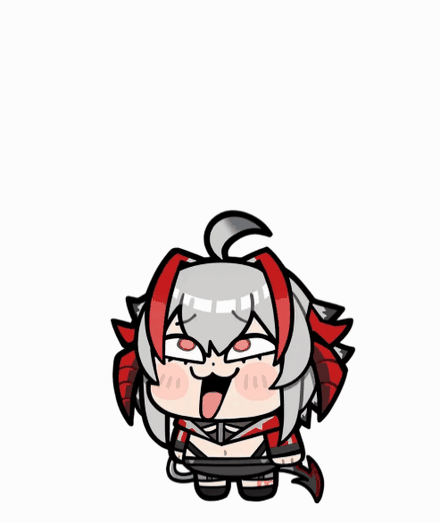
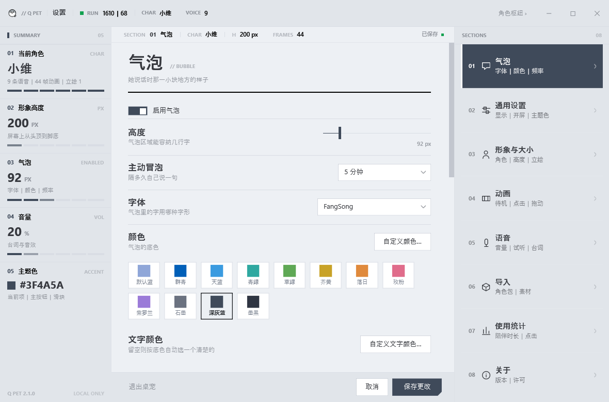
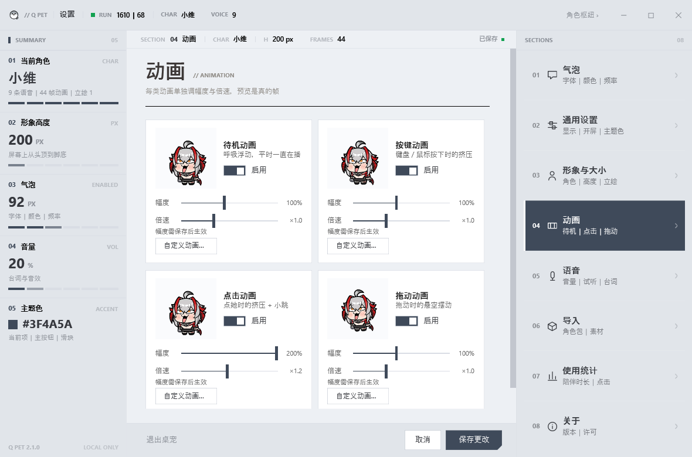
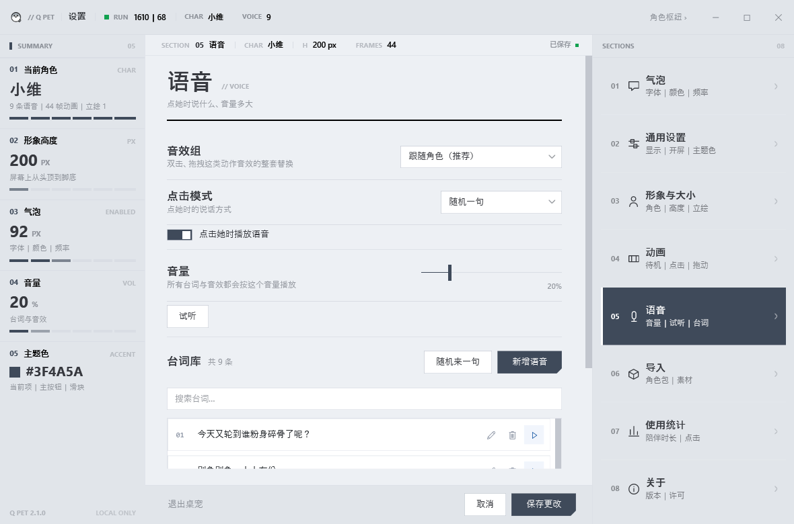
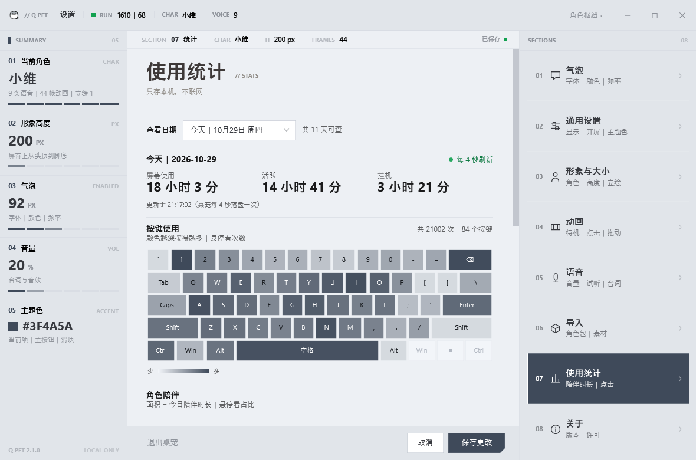

<div align="center">
  
</div>

<h1 align="center">Q Pet</h1>

<p align="center">
  把喜欢的角色放到桌面上。<br>
  Windows 桌面宠物 · 解压即用 · 不联网 · 角色随便换
</p>

<p align="center">
  
  
  
  
</p>

<p align="center">
  <a href="https://xiezaji.github.io/q-pet/">
    
  </a>
  &nbsp;
  <a href="https://github.com/xiezaji/q-pet/releases/latest">
    
  </a>
</p>

<div align="center">
  
</div>

<p align="center"><sub>待机 → 按键 → 点击冒台词并出声 → 拖动。真实录屏，没有加速。</sub></p>

Q Pet 是一款 Windows 桌面宠物：透明置顶、透明区域点击穿透、不抢焦点、不占任务栏。
点它一下会冒出台词并播放语音，拖动能换位置，下次启动回到原处。
用 Win32 + .NET Framework 4.8 写的，**不联网、不要账号、无第三方依赖**，解压就能用。

## 为什么值得试试

- **数据只在你自己电脑上。** 没有账号、没有云端同步、没有任何网络请求。屏幕时长、软件使用这些统计也只写本地文件。
- **不挡事。** 透明区域点击穿透，鼠标能直接点到下面的窗口；不抢焦点，不占任务栏；托盘里随时能关掉。
- **角色随便换。** 角色包就是一个文件夹。设置面板里选一张立绘、填个名字，就能把自己喜欢的角色做成桌宠 —— 不用装 Python，不用命令行。
- **手机也能玩。** [网页版](https://xiezaji.github.io/q-pet/) 是同一套设计的原生 JS 重写，资源只有 5.2 MB，打开链接就玩，发微信也能直接点。

## 30 秒上手

1. **[下载 win64 包](https://github.com/xiezaji/q-pet/releases/latest)**（约 7.8 MB）。
2. **先解除锁定，再解压** —— 右键 zip → 属性 → 勾选「解除锁定」→ 确定。
   这样解压出来的 exe 不带「来自其他计算机」标记，Windows 就不会弹「已保护你的电脑」。
   已经解压了也不要紧：右键 `Pet.exe` → 属性 → 勾「解除锁定」同样有效。
3. 解压到任意目录（不用安装），双击 **`Pet.exe`**。双击 **`PetSettings.exe`** 是设置面板，双击托盘图标也能打开。

> 系统要求：Windows 10 / 11（x64）。.NET Framework 4.8 系统自带，不用另装。
>
> **不想下载？**[网页版](https://xiezaji.github.io/q-pet/) 直接开，手机也行。

## 操作

| 操作 | 效果 |
|---|---|
| 左键点击角色 | 随机台词气泡 + 对应语音 |
| 按住拖动角色 | 移动位置并记住，下次启动回原处 |
| 右键角色 / 右键托盘图标 | 菜单（设置 / 退出） |
| 双击托盘图标 | 打开设置面板 |
| 在气泡上滚轮或拖动 | 翻阅长台词 |

## 换角色

设置面板 →「导入」页：填名字、选一张立绘（png/jpg）、选一个语音文件夹，点「创建」。
动画帧在进程内生成，**不需要 Python、不需要 Pillow**。之后在「形象与大小」页切换即可。

「动画」页还能把某一类动作换成自己的 GIF / 一组图，或者一键恢复默认。

> 发布包默认只带一套角色（7.8 MB，好传）。想要更多，用一张立绘自己做，或者从仓库 `chars/` 里拷。

<details>
<summary><b>角色包结构（想手工做一个的话）</b></summary>

```text
chars/
└─ 角色名/
   ├─ char.json          角色清单
   ├─ 图片/image.png     立绘
   ├─ 动画/frames.bin    动画帧（预乘 BGRA）
   ├─ 动画/frames.txt    尺寸与帧数元数据
   ├─ 动画/preview.png   预览图
   ├─ 台词.txt           气泡台词（一行一句）
   └─ 音效/
      ├─ voices.tsv      台词 <TAB> 语音路径
      ├─ voices/*.wav
      ├─ press.wav       可选：按压音
      └─ release.wav     可选：松开音
```

`char.json` 示例：

```ini
name=小维
image=图片/image.png
frames=动画/frames.bin
meta=动画/frames.txt
lines=台词.txt
voicelines=音效/voices.tsv
press=音效/voices/xxx.wav
release=音效/voices/yyy.wav
charH=200
```

`frames.txt` 里的 `fps` 决定播放速度（30 ⇒ 每帧 33 ms），`w` / `h` 必须和 `frames.bin` 对得上。

语音只支持 `.wav`。`.mp3` / `.m4a` / `.ogg` 要先转码 —— 把 `ffmpeg.exe` 放到
`Pet.exe` 旁边（或者同目录下的 `tools\` 里），导入时会自动调用；
没有 ffmpeg 就跳过这几个文件，wav 照常导入。

</details>

## 设置中心

Windows 11 Fluent 风格，改完即时生效。点图片看原始尺寸。

| 气泡外观 | 动画调校 |
| :---: | :---: |
| <a href="docs/images/settings-bubble.png"></a> | <a href="docs/images/settings-anim.png"></a> |
| 四种外框，颜色、字体、字号都能改 | 四类动画独立开关，幅度与倍速可调 |
| **语音台词** | **使用统计** |
| <a href="docs/images/settings-voice.png"></a> | <a href="docs/images/settings-stats.png"></a> |
| 台词与语音一一对应，可试听、编辑、删除 | 屏幕 / 活跃 / 软件 / 按键 / 陪伴时长，可导出 CSV |

## 常见问题

| 现象 | 处理 |
|---|---|
| 双击后没反应 | 确认 zip 已完整解压，`Pet.exe` 和 `chars\` 在同一目录。启动失败现在会**弹窗**说明原因，不再静默 |
| 弹「Windows 已保护你的电脑」 | 按上面第 2 步「解除锁定」；或点「更多信息 → 仍要运行」 |
| 桌宠跑到屏幕外 | 拔显示器 / 改分辨率后会自动夹回可视区；也可以删掉 `pet-pos.txt` 让它回默认位置 |
| 重复双击开了好几只 | 不会。单实例互斥体，已有实例时会把设置面板叫出来 |
| 日志会不会越堆越多 | 不会。`pet-status.txt` 只留当天，跨天归档，归档只保留 7 天 |
| 想把统计导出 | 设置面板「统计」页 →「导出 CSV」 |
| 换电脑继续用 | 复制整个文件夹即可；`pet-pos.txt`、`pet-stats*.txt` 可留可删 |
| 不想用预编译 exe | 从源码自己编，见 [docs/DEVELOP.md](docs/DEVELOP.md) |

## 隐私

- 程序**不联网**，没有账号，没有云端同步，不会上传任何数据。
- 全局键鼠钩子只用于触发动画；开启按键统计时读取虚拟键码（如 A、Ctrl）并累计次数，**不记录输入内容**。
- 统计只记屏幕与活跃时长、前台软件的进程名、按键次数、角色陪伴时长，写入本地 `pet-stats.txt` 及按天归档；不记录窗口标题。可一键清空，`statsKeys=0` 可关掉按键统计。

## 素材与版权

内置角色的立绘、语音等素材版权归原权利方所有，**仅供个人学习与自用，请勿用于商业用途或二次分发**。

代码部分以 [MIT 许可证](LICENSE) 授权；角色素材不包含在 MIT 授权范围内，详见 [NOTICE.md](NOTICE.md)。

想基于本项目做自己的桌宠，请自备拥有使用权的立绘与语音，按上面的角色包结构放进 `chars/你的角色/` 即可，程序代码可以直接沿用。

## 开发者

构建、单元测试、`--selftest`、XAML 编辑、配置键表、打包分发 —— 都在 **[docs/DEVELOP.md](docs/DEVELOP.md)**。

```bat
:: 需要 .NET SDK；一键：版本号 → XAML 校验 → 单测 → 编两个 exe → 复制到根目录
tools\build.cmd
```
